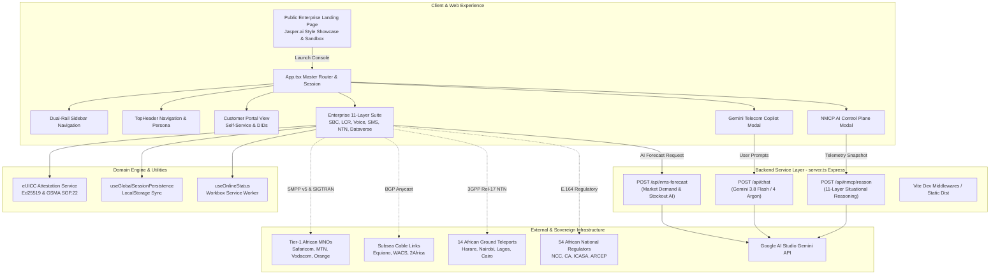
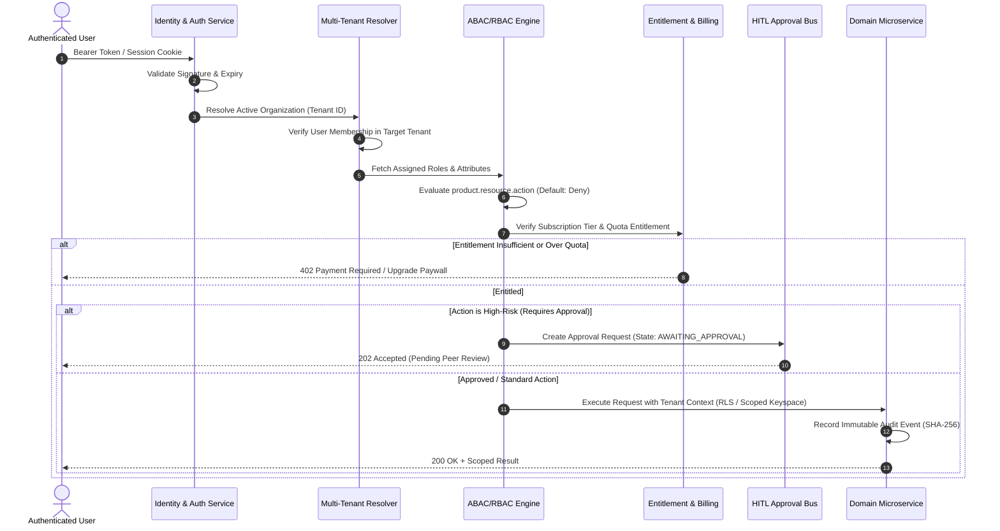
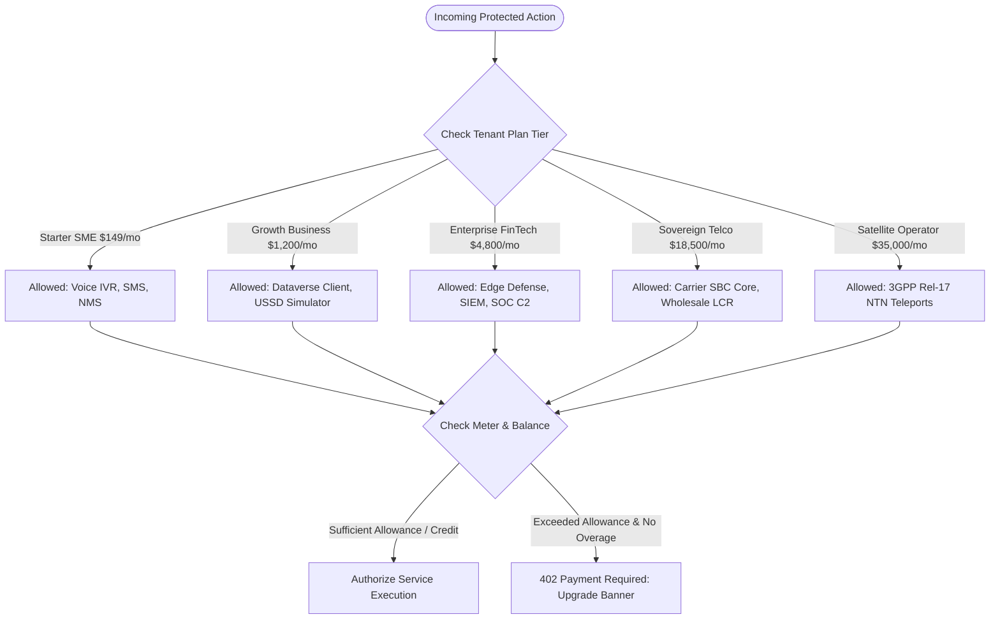

# MANDELA CORE — MASTER MULTI-TENANT PORTAL ARCHITECTURE SPECIFICATION
**Document ID:** ARCH-MND-2026-001  
**Version:** 1.0.0 (Production Release Candidate)  
**Authors:** Chief Technology Officer, Principal Software Architect, Security & Identity Architect, Platform Infrastructure Engineer, Billing & Monetization Engineer, SRE, QA Lead  
**Classification:** Sovereign Engineering Internal & Regulatory Architecture

---

## 1. Executive Summary & Repository Audit

The MANDELA CORE application has been thoroughly audited across all source directories (`/src`, `/server.ts`, `/services`, `/data`, `/types`). The platform is **not an empty shell**; it contains deep, functional domain implementations across telecom signaling, eSIM GSMA attestation, multi-tenant schemas, and AI copilot agents:

- **18 Functional Modules Identified**: 14 Existing modules, 4 Partial modules requiring integration consolidation.
- **Deepest Implemented Pillars**:
  1. *Kamailio + FreeSWITCH Anycast SBC Core* (`/src/components/sbc/`) with live 30s packet diagnostic, SIP ladder traces, and PoP drain/scale mechanisms.
  2. *Carrier Interconnect & LCR Engine* (`/src/components/interconnect/`) with dynamic rate deck ingestion and margin protection.
  3. *3GPP Rel-17 Satellite NTN* (`/src/components/satellite/`) with orbital ephemeris compensation and continental teleport tracking.
  4. *African Multilingual Voice IVR* (`/src/components/voice/`) with 50 African language models and visual node builder.
  5. *Sovereign SMS & USSD Gateway* (`/src/components/messaging/`) with direct SMPP v5 binds and feature phone USSD menu simulator.
  6. *GSMA SGP.22 eSIM Attestation* (`/src/services/euiccAttestationService.ts`) with Ed25519 cryptographic signatures and QR provisioning.
  7. *MANDELA Sovereign Dataverse* (`/src/components/dataverse/`) with dynamic schema designer, CDC event pipeline, and SHA-256 audit ledger.
  8. *Edge Defense & SOC C2* (`/src/components/edge/`) with SS7/Diameter signaling firewall, eBPF XDP scrubber, RawNet3 voice deepfake scanner, and SIM-swap quarantine.
  9. *NMCP AI Situational Engine* (`/server.ts`, `/src/components/nmcp/`) with multi-tenant context reasoning powered by `@google/genai` Gemini 3.8 Flash.
- **Critical Architectural Deficits Discovered**:
  1. *Single Shared Workspace Problem*: The entire application is rendered under an "Enterprise Suite" container alongside a rudimentary "Customer Portal", forcing all users (novices, developers, NOC ops, enterprise admins) to view the same underlying panels.
  2. *Lack of Strict Separation of Duties*: Users can toggle between `enterprise`, `developer`, `ops`, and `novice` personas with zero credential verification, allowing unauthorized operational actions (e.g. draining PoPs or isolating SIM cards).
  3. *Client-Side Tenant Isolation*: Tenant switching occurs in local React state and `localStorage` without server-side JWT cryptographic assertion.
  4. *Missing Standalone System 16 (Identity & KYC)*: Embedded inside NMS compliance instead of operating as the dedicated **Mandela Secure** identity product.
  5. *Uncentralized Human-in-the-Loop Approvals*: High-risk changes (PoP drain, BGP failover, SIM-swap quarantine) trigger local state alerts rather than routing through an auditable approval inbox.

---

## 2. Current System Architecture Map



---

## 3. Unified Portal Sitemap

To enforce strict separation of concerns, the entire platform is restructured into **5 Dedicated Portal Destinations** accessed via a unified authentication gateway:

```
MANDELA CORE UNIFIED PLATFORM
│
├── [A] CUSTOMER PORTAL (External Clients & Enterprise Developers)
│   ├── /customer/overview (Consumption gauges, active services, balance)
│   ├── /customer/my-products (Active subscriptions & allocated services)
│   ├── /customer/activate (Service catalog & instant line provisioning)
│   ├── /customer/api-developer (API keys, webhooks, sandbox console)
│   ├── /customer/usage (Metered voice minutes, SMS delivery, storage)
│   ├── /customer/billing (Invoices, top-up wallets, payment methods)
│   ├── /customer/organization (Team members, scoped roles, MFA enforcement)
│   ├── /customer/identity-security (Session logs, API restrictions, mTLS)
│   ├── /customer/support (Support tickets, incident alerts, live chat)
│   ├── /customer/notifications (Billing alerts, rate updates, quota warnings)
│   └── /customer/settings (Company profile, webhook endpoints, audit)
│
├── [B] OPERATIONS PORTAL (NOC Operators & Carrier Integration Leads)
│   ├── /ops/overview (Continental telecom traffic, health scores, CPS)
│   ├── /ops/customer-queue (Pending customer onboarding & KYC queues)
│   ├── /ops/provisioning (DID reservations, porting exceptions, eSIM orders)
│   ├── /ops/activations (Trunk activations, SMPP bind validations)
│   ├── /ops/telecom-noc (Kamailio SBC PoP status, SIP ladder monitors)
│   ├── /ops/network-noc (BGP subsea routes, Equiano/WACS failover status)
│   ├── /ops/incidents (P1-P4 incidents, outage declarations, war rooms)
│   ├── /ops/escalations (Fraud escalations, carrier grey-route quarantine)
│   ├── /ops/service-health (Real-time MOS scores, jitter, delivery SLAs)
│   ├── /ops/change-requests (Scheduled maintenance, trunk modifications)
│   └── /ops/reports (Wholesale reconciliation, margin reports, audit)
│
├── [C] ENGINEERING PORTAL (Core Network & Platform Engineers)
│   ├── /eng/overview (Service mesh topology, microservice health)
│   ├── /eng/service-catalog (Internal API contracts, proto specs, schemas)
│   ├── /eng/module-registry (18-system status, code ownership, dependencies)
│   ├── /eng/architecture (Interactive dependency explorer, data flows)
│   ├── /eng/api-contracts (OpenAPI / gRPC contracts, versioning)
│   ├── /eng/deployments (Kubernetes cluster status, canary releases)
│   ├── /eng/ci-cd (Pipeline build logs, automated regression suites)
│   ├── /eng/testing-qa (Stress test runners, SIP load injectors)
│   ├── /eng/logs-telemetry (Distributed traces, eBPF logs, Jaeger/OpenTelemetry)
│   ├── /eng/feature-flags (Dynamic runtime flags, rollout percentages)
│   ├── /eng/dependency-graph (Cross-module dependency analysis)
│   └── /eng/change-history (Git commit links, schema migrations, changelog)
│
├── [D] SECURITY & GOVERNANCE PORTAL (Compliance, Legal, SOC & CISO)
│   ├── /governance/overview (Sovereignty posture, active investigations)
│   ├── /governance/identity-policies (System 16 KYC rules, biometric limits)
│   ├── /governance/fraud-monitoring (SIM-swap velocity, ST-GNN anomaly scores)
│   ├── /governance/kyc-operations (Manual ID review queue, purpose-bound logs)
│   ├── /governance/country-compliance (AU Malabo Convention, national licenses)
│   ├── /governance/access-reviews (Quarterly role audits, privilege reviews)
│   ├── /governance/suspicious-activity (Acoustic deepfake alerts, CLI spoofing)
│   ├── /governance/approval-center (Two-person authorization inbox)
│   ├── /governance/audit-history (Immutable SHA-256 tamper-evident logs)
│   ├── /governance/data-retention (Automated GDPR/AU data deletion timers)
│   └── /governance/emergency-controls (Kill-switches, quarantine lockdowns)
│
└── [E] PLATFORM ADMINISTRATION PORTAL (System Administrators & Platform Owners)
    ├── /admin/tenant-provisioning (New organizational setup, root keyspace)
    ├── /admin/organizations (Directory of all sovereign operators & fintechs)
    ├── /admin/role-templates (Granular permission matrix editor)
    ├── /admin/permission-management (Attribute-based policy assignments)
    ├── /admin/product-catalog (Commercial plan tiers, limits, features)
    ├── /admin/billing-config (Stripe/Flutterwave gateways, tax rates)
    ├── /admin/country-config (54 African regulatory boundaries, dial codes)
    ├── /admin/infrastructure (14 Teleports, 6 PoPs, server fleet status)
    ├── /admin/service-registry (Consul/Etcd dynamic service endpoints)
    └── /admin/platform-health (Global uptime, database replication lag)
```

---

## 4. Five Core Product Portals Mapping

The existing 18 modules are mapped into the **Five Mandated Product Divisions**:

| Product Division | Existing Discovered Modules | New Capabilities Required | Customer Experience | Internal Operations Experience |
| :--- | :--- | :--- | :--- | :--- |
| **01. MANDELA CONNECT** | • SBC Anycast Core (`mod-connect-sbc-01`)<br/>• Interconnect LCR (`mod-connect-interconnect-02`)<br/>• Multilingual IVR (`mod-connect-voice-03`)<br/>• Sovereign SMS/USSD (`mod-connect-messaging-04`) | • Alphanumeric Sender ID regulatory whitelist<br/>• Webhook retry bus with dead-letter queue | Order numbers, configure SIP trunks, build IVR trees, test SMS/USSD | Trunk drain/scale, grey-route quarantine, carrier SLA monitoring |
| **02. MANDELA TELECOM** | • Sovereign NMS (`mod-telecom-nms-05`)<br/>• MNP Clearinghouse (`mod-telecom-porting-06`)<br/>• eSIM Attestation (`mod-telecom-esim-07`)<br/>• Satellite NTN (`mod-telecom-satellite-08`) | • Automated donor telco two-way SMS consent (*242#)<br/>• Real-time SIM swap verification API | Manage SIM/eSIM lifecycle, order DIDs, initiate porting, satellite feeds | Carrier onboarding, number recycling, regulatory dispute arbitration |
| **03. MANDELA SECURE** | • System 16 KYC (`mod-secure-identity-09`)<br/>• Edge Defense (`mod-secure-edge-defense-10`)<br/>• SOC C2 Matrix (`mod-secure-soc-c2-11`) | • Purpose-bound PII viewing tokens<br/>• Formal identity denial appeal workflow<br/>• Biometric matching threshold editor | Configure KYC checks, view attestation proofs, inspect auth metrics | Fraud queue, biometric health, national ID adapter status, audit logs |
| **04. MANDELA CLOUD** | • Sovereign Dataverse (`mod-cloud-dataverse-12`)<br/>• Infrastructure Fleet (`mod-cloud-infrastructure-13`) | • AST query sanitizer for QueryStudio<br/>• Regional compute quota provisioning UI | Define schemas, query records, subscribe to CDC events, monitor spend | Regional PoP capacity, storage quota management, lakehouse tiers |
| **05. MANDELA INTELLIGENCE (MANDELA OS)** | • NMCP Reasoning (`mod-intel-nmcp-14`)<br/>• Gemini Copilot (`mod-intel-copilot-15`) | • Server-side tool execution authorization<br/>• AI-recommended action approval bus | Contextual telecom AI copilot, automated incident summaries | Cross-system reasoning, automated dependency graph, impact analysis |

---

## 5. Multi-Tenant Control Plane & Session Resolution Model

Every authenticated interaction in Mandela Core executes through an uncompromising, server-validated pipeline:



### Context Resolution Entity Hierarchy:
```
Platform
  └── Organization (e.g., Safaricom Group, Ecobank Transnational)
        └── Tenant (e.g., tenant-ke-safaricom-01, tenant-ng-ecobank-prod)
              ├── Memberships (User <-> Tenant mappings)
              ├── Subscriptions (Plan Tier, Invoices, Prepaid Balance)
              ├── Entitlements (Allowed Products, Max CPS, Quotas)
              ├── Resources (DIDs, eSIM Profiles, SIP Trunks, Schemas)
              └── Audit Events (Cryptographic SHA-256 Ledger)
```

---

## 6. Role & Permission Matrix (`product.resource.action`)

The platform implements **Attribute-Based Access Control (ABAC)** layered over **Role-Based Access Control (RBAC)**:

| Role Name | Scope | Permissions Granted (`product.resource.action`) | Restrictions & Invariants |
| :--- | :--- | :--- | :--- |
| **Customer Owner** | Tenant-wide | `customer.*`, `connect.*.read`, `billing.*`, `platform.team.*` | Cannot approve high-risk carrier infrastructure changes; cannot view internal platform queues |
| **Communications Developer**| Tenant-wide | `connect.numbers.reserve`, `connect.voice.flow_edit`, `connect.messaging.send`, `connect.api.*` | Cannot upgrade subscription tier; cannot view raw customer KYC documents |
| **Customer Compliance Lead** | Tenant-wide | `secure.identity.verify`, `secure.identity.review`, `secure.identity.appeal`, `audit.read` | Access to PII is purpose-bound, watermarked, and time-limited to 15-minute review sessions |
| **Carrier Operations Spec.**| Operations | `connect.sbc.configure`, `connect.interconnect.*`, `telecom.routes.*` | Cannot view customer private SMS contents or end-user identity records |
| **Porting Specialist** | Operations | `telecom.porting.review`, `telecom.porting.approve`, `telecom.porting.escalate` | Actions logged to national regulatory clearinghouse audit bus |
| **Fraud Investigator** | Security | `secure.soc.read`, `secure.soc.isolate_subscriber`, `secure.fraud.*` | Must state case ticket ID before executing SIM-swap quarantine lockdown |
| **Cloud Reliability Eng.** | Engineering| `cloud.compute.*`, `cloud.storage.*`, `eng.telemetry.*`, `eng.deploy.*` | Zero access to tenant relational records or unmasked database tables |
| **Country Compliance Off.**| Governance | `governance.country.*`, `governance.audit.*`, `regulatory.reports.*` | Enforces African Union Malabo Convention; cannot alter billing terms |
| **Platform Administrator** | Platform | `admin.tenants.*`, `admin.roles.*`, `admin.catalog.*`, `admin.health.*` | Scoped privileges only; no universal backdoor into customer tenant data |

---

## 7. Product Entitlement, Paywalls & Monetization Model

Every product capability is guarded by an explicit entitlement verification gate:



### Commercial Entitlement Tiers:
1. **Starter SME ($149/mo)**: 50 CPS, 25k SMS/mo, 10 concurrent voice channels, 5 DIDs, customer self-service.
2. **Growth Business ($1,200/mo)**: 250 CPS, 250k SMS/mo, 60 voice channels, 25 DIDs, 2 GB Dataverse storage, USSD simulator.
3. **Enterprise FinTech ($4,800/mo)**: 1,500 CPS, 2.5M SMS/mo, 400 voice channels, 100 DIDs, full SOC C2, voice deepfake scanner.
4. **Sovereign Telco ($18,500/mo)**: 10,000 CPS, 25M SMS/mo, 2,000 voice channels, 500 DIDs, Anycast SBC, wholesale LCR engine.
5. **Satellite Operator ($35,000/mo)**: 25,000 CPS, unlimited SMS/voice, 14 ground teleports, direct-to-device LEO constellation feed.

---

## 8. Human-in-the-Loop Workflow State Machine

High-consequence operational mutations (PoP drains, bulk number releases, BGP overrides, SIM-swap lockdowns) must follow the mandatory finite state machine:

```mermaid
stateDiagram-v2
    [*] --> REQUESTED: Operator initiates high-risk action
    REQUESTED --> VALIDATING: System validates payload schema & credentials
    VALIDATING --> AUTHORIZED: Requester role has permission
    VALIDATING --> REJECTED: Schema error or unauthorized role

    AUTHORIZED --> POLICY_CHECKED: ABAC country rules & tenancy verified
    POLICY_CHECKED --> AWAITING_APPROVAL: High-risk policy trigger requires peer review

    AWAITING_APPROVAL --> NEEDS_REVIEW: Escalated due to high financial/network impact
    AWAITING_APPROVAL --> REJECTED: Approver denies request
    AWAITING_APPROVAL --> CANCELLED: Requester cancels before approval
    AWAITING_APPROVAL --> PROCESSING: Peer approver signs with MFA

    NEEDS_REVIEW --> PROCESSING: Secondary executive approval granted
    NEEDS_REVIEW --> REJECTED: Executive review denies action

    PROCESSING --> COMPLETED: Action committed; SHA-256 audit log written
    PROCESSING --> FAILED: Downstream carrier/network fault
    FAILED --> ROLLBACK_PENDING: Automated rollback sequence triggered
    ROLLBACK_PENDING --> ROLLED_BACK: Network state restored to baseline

    COMPLETED --> [*]
    REJECTED --> [*]
    CANCELLED --> [*]
    ROLLED_BACK --> [*]
```

---

## 9. Missing Infrastructure Dependencies & Gap Analysis

| Category | Missing Component / Gap | Impact | Remediation Strategy |
| :--- | :--- | :--- | :--- |
| **Authentication** | Server-side JWT issuing with tenant claims | Client can forge tenant context | Implement `/api/auth/token` with HMAC-SHA256 and validate on all Express routes |
| **Database** | Relational Row-Level Security (RLS) | Relies on application-level filtering | Provision Cloud SQL PostgreSQL or configure explicit `tenant_id` WHERE clause enforcement |
| **HITL Approvals** | Centralized Approval Center Inbox | Approvals exist only as mock alerts | Build unified `/governance/approval-center` UI and queue endpoint |
| **System 16 KYC** | Dedicated Mandela Secure portal | KYC mixed into NMS compliance tab | Extract KYC to dedicated `Mandela Secure` workspace with purpose-bound review tokens |
| **Payment Gateway** | Live webhook verification | Client can simulate wallet top-ups | Implement signed Stripe/Flutterwave webhook validation endpoints |
| **AI Safety** | Server-side tool execution gate | AI could generate privileged commands | Enforce server-side permission check before executing any AI tool action |

---

## 10. Prioritized 10-Phase Integration Roadmap

```
PHASE 0: Discovery, Architecture Audit & Machine-Readable Registry [COMPLETED]
         ├── Source code discovery across /src, /server.ts, /services
         ├── Creation of docs/architecture/module-registry.json (18 modules)
         └── Production of Master Architecture Specification (ARCH-MND-2026-001)

PHASE 1: Shared Identity, Tenant Resolution & Service Registry
         ├── Centralize multi-tenant context (User -> Identity -> Tenant -> Role)
         ├── Server-side JWT issuance and middleware validation
         └── Implement explicit Default-to-Deny permission checker

PHASE 2: Unified Portal Navigation & 5 Role-Specific Workspace Shells
         ├── Implement 5 Portals: Customer, Operations, Engineering, Security, Admin
         ├── Global portal launcher and organization context switcher
         └── Strict URL routing: /customer/*, /ops/*, /eng/*, /governance/*, /admin/*

PHASE 3: Product Catalog, Billing, Entitlements & Paywall Enforcement
         ├── Unified entitlement check hook (`useEntitlement('connect.sbc')`)
         ├── Server-side paywall gate on billable API endpoints
         └── Customer wallet top-up and plan upgrade flow

PHASE 4: Human-in-the-Loop Workflow Orchestration & Approval Center
         ├── Workflow finite state machine engine with peer separation of duties
         ├── Centralized Approval Center inbox in Operations and Governance
         └── Immutable SHA-256 audit ledger integration

PHASE 5: Connect & Telecom Module Integration
         ├── Consolidate SBC Core, Interconnect LCR, Voice IVR, and SMS Gateway
         └── Bind E.164 Number Management, MNP Porting, and SGP.22 eSIM Suite

PHASE 6: Secure & System 16 Integration
         ├── Standalone Mandela Secure Workspace
         ├── Country ID policy registry with purpose-bound PII masking
         └── Biometric matching threshold calibration and appeal workflows

PHASE 7: Cloud Infrastructure Integration
         ├── Regional PoP compute and storage capacity manager
         └── Dynamic Dataverse schema designer with AST query sanitization

PHASE 8: Mandela Intelligence (OS) Orchestration
         ├── NMCP situational reasoning engine with server-side authorized actions
         └── Multi-turn Gemini AI copilot with tenant-isolated memory

PHASE 9: End-to-End Stress Testing & Progressive Rollout
         ├── Automated multi-tenant isolation test suite
         ├── Separation-of-duties enforcement verification
         └── Full operational readiness scorecard
```
